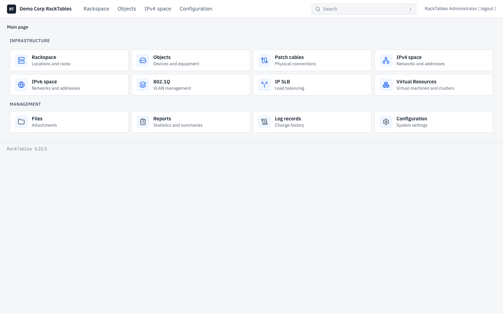
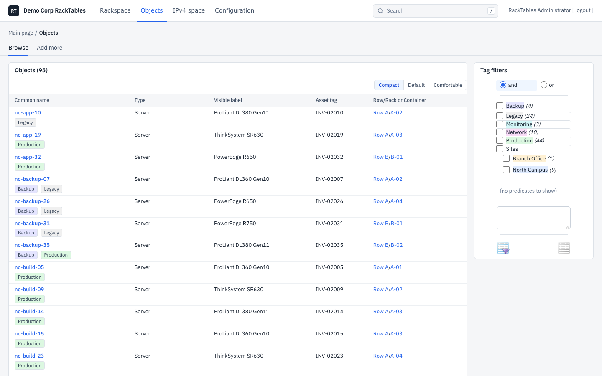
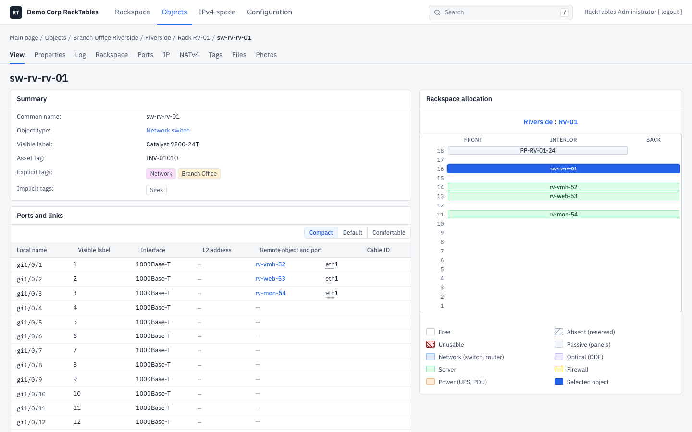
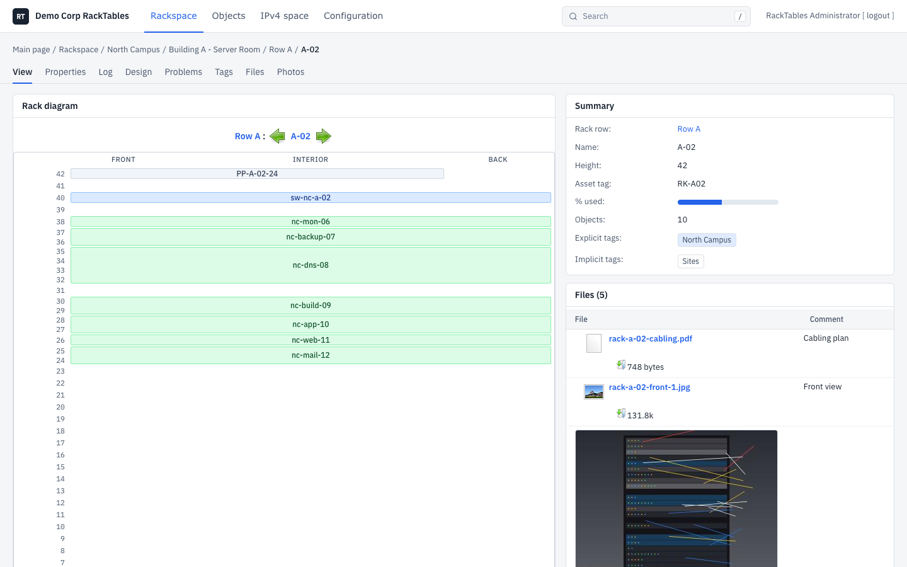
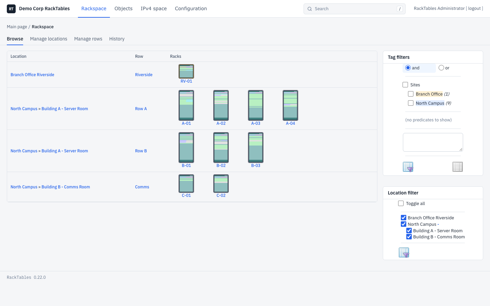
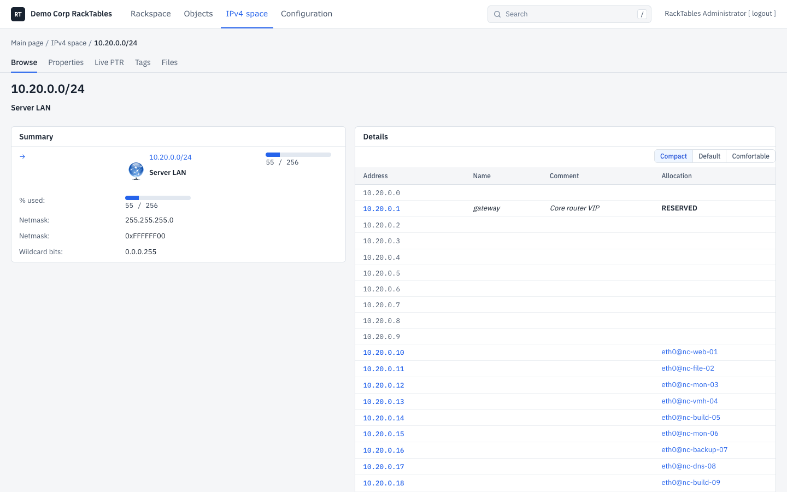
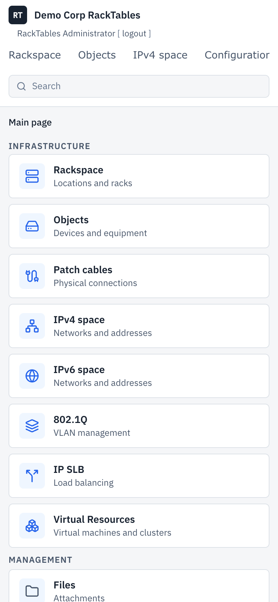
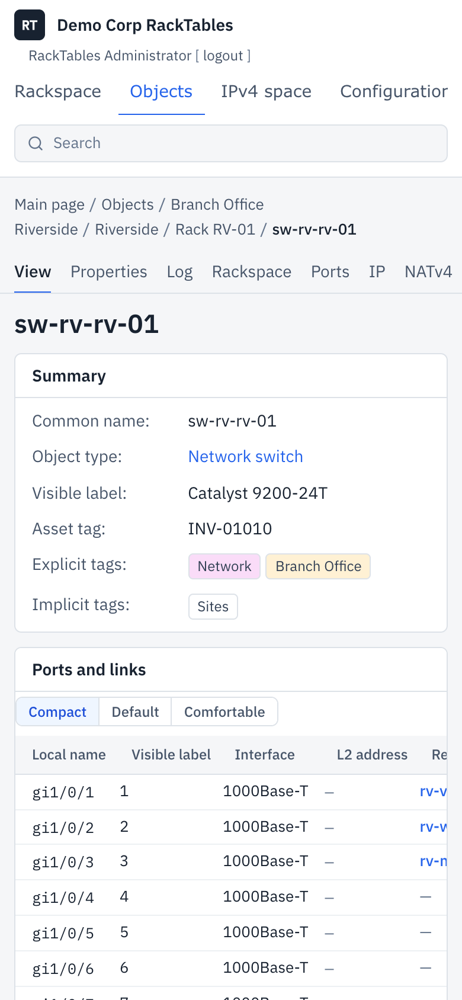

# RackTables Redesign Theme

A redesign of the [RackTables](https://www.racktables.org/) interface, packaged as a plugin
(`redesigntheme`). It does not modify RackTables core files. It is the successor of the
lighter *Refresh Theme* (`refreshtheme`). Enable only one of the two at a time.

## Screenshots

Taken on a demo instance with generated data (no real records).

| | |
|---|---|
| **Main page**<br> | **Objects**<br> |
| **Object**<br> | **Rack**<br> |
| **Rackspace**<br> | **IPv4 network**<br> |

**Mobile**

 

## Layers

**Core (CSS only, works without JavaScript)**

- Design tokens (colors, radius, spacing), IBM Plex Sans / Mono hosted locally.
- 52 px white header with logo mark, section links with active underline, user + logout.
- Breadcrumb bar, underlined tabs, cards instead of dashed portlets.
- Tables: 12 px muted headers, sticky header row, row separators, hover, no zebra,
  empty cells shown as an em dash.
- Tags as chips (implicit tags dashed), no row tinting in object lists.
- Forms: 32 px controls, visible focus ring, primary / secondary / disabled buttons.
- Main page: Lucide icons, tile descriptions, *Infrastructure* and *Management* groups
  (the tile order is set in `plugin.php` via `$indexlayout`; tiles still respect permissions).
- Configuration page as tiles.
- Rack diagram: blocks colored by object type (network, server, optical, passive,
  firewall, power), selected object in solid blue, absent / unusable as hatches.
  `plugin.php` emits one CSS rule per mounted object (`:has()` selector); the type group
  comes from stock dictionary IDs, site specific types are matched by name
  (ODF / optic -> optical, ...). Adjust `redesigntheme_type_group()` if needed.
- Rackspace: racks in fixed width columns (long rack names wrap instead of shifting racks).
- Mobile layout below 768 px (the plugin adds the viewport meta RackTables lacks): stacked
  columns, scrollable tabs and wide tables, one column tiles, 16 px form controls.
- IPv4/IPv6 network: allocated addresses blue, free addresses in secondary gray (AA contrast).

**Enhanced (optional, `js/enhance.js`)**

- Search field moved into the header; `/` focuses it.
- Active header link, `/` as breadcrumb separator, RackTables version in the footer.
- Table density switch (Compact / Default / Comfortable), remembered per browser.
- Copy button next to IP and MAC addresses.
- Rack legend under the diagram; rack page shows the diagram first (~62 % width).
- Token colored "% used" bars instead of RackTables' bitmap bars.
- Type-to-filter field above long drop-down lists (`js/select-filter.js`, from Refresh Theme).

## Compatibility

Tested with RackTables **0.22.0** in current Chrome. Needs a browser with CSS `:has()`
(Chrome/Edge 105+, Safari 15.4+, Firefox 121+).

Note: RackTables serves plugin files through `?module=chrome`, which only accepts
file extensions made of letters. That is why fonts ship as `.woff`, not `.woff2`.

## Installation

1. Copy the `redesigntheme` directory into the RackTables `plugins/` directory.
2. In **Configuration -> Plugins**, disable *Refresh Theme* (if installed) and install
   **Redesign Theme**.
3. Hard refresh the browser (Ctrl+Shift+R).

```dockerfile
COPY redesigntheme /var/www/racktables/plugins/redesigntheme
```

## Licenses

- Plugin code: GPL-2.0 (see `LICENSE`), same as RackTables.
- IBM Plex fonts: SIL Open Font License 1.1 (`redesigntheme/fonts/OFL-IBM-Plex.txt`).
- Lucide icons: ISC (`redesigntheme/icons/LICENSE-lucide.txt`).
